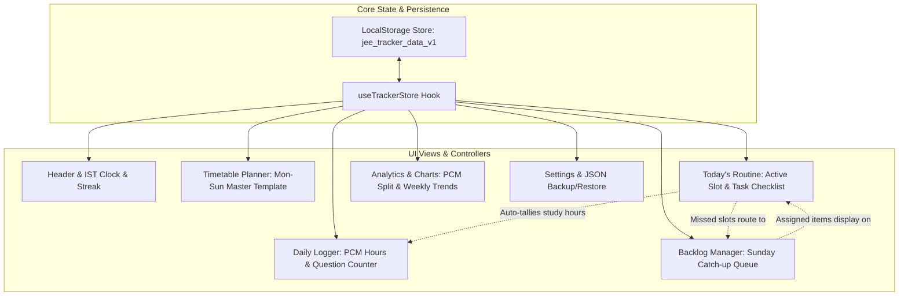

# Class 11 JEE Aspirant Daily Routine & Timetable Tracker Implementation Plan

> **For agentic workers:** REQUIRED SUB-SKILL: Use superpowers:subagent-driven-development (recommended) or superpowers:executing-plans to implement this plan task-by-task. Steps use checkbox (`- [ ]`) syntax for tracking.

**Goal:** Build a high-performance, distraction-free web application tailored for a Class 11 JEE aspirant to plan a day-wise weekly timetable, execute and track routines in real time, record daily study output (PCM hours, question solving targets, reflections), manage backlogs, and visualize preparation consistency.

**Architecture:** A modern single-page application built on Vite, React, and Tailwind CSS. State is managed reactively via custom React hooks backed by local storage persistence with JSON export/import capabilities. Real-time scheduling logic decodes 24-hour time slots to highlight active tasks and trigger countdowns, while completed tasks automatically synchronize with the daily performance logger.

**Architecture Diagram:**



**Tech Stack:** React 19 / TypeScript / Vite / Tailwind CSS / Lucide React / Canvas-Confetti / Vitest for testing

**Spec:** [docs/superpowers/specs/2026-11-17-jee-tracker-design.md](file:///c:/Users/Dev/Desktop/Tracker/docs/superpowers/specs/2026-11-17-jee-tracker-design.md)

---

## Global Constraints

- **Platform & Environment:** Windows 10/11, Node.js v24+, standard modern evergreen browsers (Chrome, Edge, Firefox).
- **Storage:** LocalStorage namespace key `jee_tracker_data_v1` with graceful recovery on corrupted data.
- **Copy & Terminology:** Tailored for IIT-JEE aspirants (Physics, Chemistry, Mathematics, Coaching, Self-Study, Revision, DPPs, Backlogs).
- **Responsiveness:** Fluid desktop-first layout that collapses cleanly into a single-column layout for mobile / tablet screens.

---

## Review Focus

1. **Midnight rollover & timezone handling:** When the system clock crosses midnight or when user checks past/future dates, the app must correctly display that day's specific date routine without corrupting time-slot comparisons.
2. **Missing or corrupt localStorage data:** If local storage is empty, partially corrupted, or from an outdated schema version, the app must fallback to the Class 11 JEE default starter preset without crashing.
3. **Invalid or overlapping time slot inputs:** When adding or editing a time slot, start time must precede end time, and slots spanning across midnight must be handled gracefully.
4. **Zero-division and empty analytics:** When a new user has no logged study hours or question counts, all charts and streak counters must display helpful empty states instead of `NaN%` or broken graphs.
5. **Backlog bi-directional sync:** Marking a backlog task as completed inside Sunday's routine must also mark `resolved: true` in the master backlog box.

---

## Tasks

### Task 1: Scaffolding Vite + React + Tailwind CSS + Vitest Project

**Files:**
- Create: `package.json`
- Create: `vite.config.ts`
- Create: `tsconfig.json`
- Create: `tsconfig.node.json`
- Create: `tailwind.config.js`
- Create: `postcss.config.js`
- Create: `index.html`
- Create: `src/main.tsx`
- Create: `src/index.css`
- Create: `src/App.tsx`
- Test: `src/App.test.tsx`

**Interfaces:**
- Consumes: None (root scaffolding)
- Produces: Running Vite development server and working Vitest test runner

- [ ] **Step 1: Write the failing test**

In `src/App.test.tsx`:
```tsx
import { render, screen } from '@testing-library/react';
import { describe, it, expect } from 'vitest';
import App from './App';

describe('App Smoke Test', () => {
  it('renders application title', () => {
    render(<App />);
    expect(screen.getByText(/JEE/i)).toBeDefined();
  });
});
```

- [ ] **Step 2: Run test to verify it fails**

Run: `npx vitest run src/App.test.tsx`  
Expected: FAIL (Cannot find package / files do not exist yet)

- [ ] **Step 3: Setup Vite project configuration and install dependencies**

Install dependencies: `react`, `react-dom`, `lucide-react`, `canvas-confetti`.  
DevDependencies: `vite`, `@vitejs/plugin-react`, `tailwindcss`, `postcss`, `autoprefixer`, `typescript`, `@types/react`, `@types/react-dom`, `@types/canvas-confetti`, `vitest`, `jsdom`, `@testing-library/react`.  
Configure `tailwind.config.js` with dark mode support and custom theme colors (emerald for Physics, amber for Chemistry, blue for Maths, purple for Coaching, indigo for Revision).  
Implement minimal `src/App.tsx` with header containing "Class 11 JEE Aspirant Tracker".

- [ ] **Step 4: Run test to verify it passes**

Run: `npx vitest run src/App.test.tsx`  
Expected: PASS

- [ ] **Step 5: Commit**

```bash
git add .
git commit -m "feat: scaffold Vite React Tailwind project with Vitest setup"
```

---

### Task 2: Core Data Types, Storage Engine, and Time Utility Functions

**Files:**
- Create: `src/types/index.ts`
- Create: `src/utils/time.ts`
- Create: `src/utils/starterData.ts`
- Create: `src/utils/storage.ts`
- Test: `src/utils/time.test.ts`
- Test: `src/utils/storage.test.ts`

**Interfaces:**
- Consumes: Types from `src/types/index.ts`
- Produces:
  - `getCurrentTime24(): string`
  - `isSlotActive(startTime: string, endTime: string, currentTime: string): boolean`
  - `getMinutesRemaining(endTime: string, currentTime: string): number`
  - `formatMinutesToHours(minutes: number): string`
  - `loadAppState(): AppState`
  - `saveAppState(state: AppState): void`
  - `exportDataAsJSON(state: AppState): void`
  - `importDataFromJSON(jsonString: string): AppState`

- [ ] **Step 1: Write the failing tests**

In `src/utils/time.test.ts`:
```typescript
import { describe, it, expect } from 'vitest';
import { isSlotActive, getMinutesRemaining, calculateSlotDurationMinutes } from './time';

describe('Time utilities', () => {
  it('correctly detects active time slots', () => {
    expect(isSlotActive('06:00', '07:30', '06:45')).toBe(true);
    expect(isSlotActive('06:00', '07:30', '08:00')).toBe(false);
  });

  it('calculates minutes remaining until slot end', () => {
    expect(getMinutesRemaining('07:30', '07:00')).toBe(30);
    expect(getMinutesRemaining('07:30', '07:30')).toBe(0);
  });

  it('calculates duration in minutes', () => {
    expect(calculateSlotDurationMinutes('06:00', '07:30')).toBe(90);
  });
});
```

In `src/utils/storage.test.ts`:
```typescript
import { describe, it, expect, beforeEach } from 'vitest';
import { loadAppState, saveAppState } from './storage';

describe('Storage Engine', () => {
  beforeEach(() => {
    localStorage.clear();
  });

  it('loads starter preset when storage is empty', () => {
    const state = loadAppState();
    expect(state.timetable.Monday.length).toBeGreaterThan(0);
    expect(state.settings.targetYear).toBe('2027');
  });

  it('persists and retrieves updated state', () => {
    const state = loadAppState();
    state.settings.studentName = 'Arjun';
    saveAppState(state);
    const loaded = loadAppState();
    expect(loaded.settings.studentName).toBe('Arjun');
  });
});
```

- [ ] **Step 2: Run tests to verify they fail**

Run: `npx vitest run src/utils/time.test.ts src/utils/storage.test.ts`  
Expected: FAIL (Cannot find modules)

- [ ] **Step 3: Implement types, time functions, starter preset, and storage engine**

- Define `TimeSlot`, `DateRoutineSlot`, `DailyRoutineRecord`, `DailyLogRecord`, `BacklogItem`, and `AppState` in `src/types/index.ts`.
- Implement time math in `src/utils/time.ts` (parsing `HH:MM` into minutes from midnight, duration calculation, remaining minutes).
- Implement Class 11 JEE starter schedule in `src/utils/starterData.ts` (Physics HC Verma, Organic Chemistry notes, Math DPPs, Coaching slots, Sunday Revision).
- Implement robust `loadAppState()`, `saveAppState()`, `exportDataAsJSON()`, `importDataFromJSON()` in `src/utils/storage.ts`.

- [ ] **Step 4: Run tests to verify they pass**

Run: `npx vitest run src/utils/time.test.ts src/utils/storage.test.ts`  
Expected: PASS

- [ ] **Step 5: Commit**

```bash
git add src/types src/utils
git commit -m "feat: implement data types, storage engine, time utilities, and JEE starter preset"
```

---

### Task 3: Day-Wise Master Timetable Planner & Slot Editor

**Files:**
- Create: `src/components/TimetablePlanner.tsx`
- Create: `src/components/SlotModal.tsx`
- Create: `src/components/ConfirmModal.tsx`
- Test: `src/components/TimetablePlanner.test.tsx`

**Interfaces:**
- Consumes: `AppState`, `TimeSlot`, `Subject` from `src/types`
- Produces:
  - Interactive weekday selector (Monday through Sunday)
  - Time slot listing sorted chronologically
  - Add / Edit / Delete time slot modal with validation
  - "Copy to Weekdays" duplication tool
  - "Reset to JEE Preset" action

- [ ] **Step 1: Write the failing test**

In `src/components/TimetablePlanner.test.tsx`:
```tsx
import { render, screen, fireEvent } from '@testing-library/react';
import { describe, it, expect, vi } from 'vitest';
import TimetablePlanner from './TimetablePlanner';
import { getStarterAppState } from '../utils/starterData';

describe('TimetablePlanner Component', () => {
  it('renders days of week and shows slots for selected day', () => {
    const state = getStarterAppState();
    const onUpdate = vi.fn();
    render(<TimetablePlanner state={state} onUpdateState={onUpdate} />);

    expect(screen.getByText('Monday')).toBeDefined();
    expect(screen.getByText('Sunday')).toBeDefined();
    expect(screen.getByText(/Add Time Slot/i)).toBeDefined();
  });

  it('allows switching active day tab', () => {
    const state = getStarterAppState();
    const onUpdate = vi.fn();
    render(<TimetablePlanner state={state} onUpdateState={onUpdate} />);

    const sundayTab = screen.getByRole('button', { name: /Sunday/i });
    fireEvent.click(sundayTab);
    expect(screen.getByText(/Revision & Backlog Clearance/i)).toBeDefined();
  });
});
```

- [ ] **Step 2: Run test to verify it fails**

Run: `npx vitest run src/components/TimetablePlanner.test.tsx`  
Expected: FAIL (Component does not exist)

- [ ] **Step 3: Implement TimetablePlanner, SlotModal, and ConfirmModal**

- Implement tabbed day selector with slot count and total hours summary.
- Display slot cards with colored subject badges, start/end time, task description, and edit/delete icons.
- Implement `SlotModal` form with inputs: Start Time (`<input type="time">`), End Time, Subject select dropdown, Task title, Notes.
- Add "Copy current day schedule to all weekdays" feature.
- Add "Load Class 11 JEE Preset" with confirmation dialog.

- [ ] **Step 4: Run test to verify it passes**

Run: `npx vitest run src/components/TimetablePlanner.test.tsx`  
Expected: PASS

- [ ] **Step 5: Commit**

```bash
git add src/components/TimetablePlanner.tsx src/components/SlotModal.tsx src/components/ConfirmModal.tsx src/components/TimetablePlanner.test.tsx
git commit -m "feat: implement day-wise master timetable planner and slot modal"
```

---

### Task 4: Today's Routine Execution Dashboard & Active Slot Tracker

**Files:**
- Create: `src/components/TodayRoutine.tsx`
- Create: `src/components/ActiveSlotCard.tsx`
- Create: `src/components/ProgressBar.tsx`
- Test: `src/components/TodayRoutine.test.tsx`

**Interfaces:**
- Consumes: `AppState`, `DateRoutineSlot`, `time.ts` helpers
- Produces:
  - Real-time active task card highlighting what the student should do right now with live countdown
  - Timeline of all tasks for today
  - 1-click status actions: `Completed` (✅), `In Progress` (⏳), `Skipped / Backlog` (⚠️)
  - Daily completion progress indicator
  - Automatic push of skipped tasks to `backlogs` array

- [ ] **Step 1: Write the failing test**

In `src/components/TodayRoutine.test.tsx`:
```tsx
import { render, screen, fireEvent } from '@testing-library/react';
import { describe, it, expect, vi } from 'vitest';
import TodayRoutine from './TodayRoutine';
import { getStarterAppState } from '../utils/starterData';

describe('TodayRoutine Component', () => {
  it('renders today routine slots and progress bar', () => {
    const state = getStarterAppState();
    const onUpdate = vi.fn();
    render(<TodayRoutine state={state} onUpdateState={onUpdate} selectedDate="2026-11-17" />);

    expect(screen.getByText(/Today's Schedule/i)).toBeDefined();
    expect(screen.getByText(/Daily Progress/i)).toBeDefined();
  });

  it('updates slot status to completed when done clicked', () => {
    const state = getStarterAppState();
    const onUpdate = vi.fn();
    render(<TodayRoutine state={state} onUpdateState={onUpdate} selectedDate="2026-11-17" />);

    const doneButtons = screen.getAllByRole('button', { name: /Done|Complete/i });
    fireEvent.click(doneButtons[0]);
    expect(onUpdate).toHaveBeenCalled();
  });
});
```

- [ ] **Step 2: Run test to verify it fails**

Run: `npx vitest run src/components/TodayRoutine.test.tsx`  
Expected: FAIL

- [ ] **Step 3: Implement TodayRoutine, ActiveSlotCard, and ProgressBar**

- Detect today's day of week from `selectedDate` and initialize `DailyRoutineRecord` from master timetable template if not already present.
- Identify current active slot based on local time and render `ActiveSlotCard` with countdown timer, subject badge, and quick status buttons.
- Render all slots chronologically with status pill (`Completed`, `In Progress`, `Pending`, `Backlog`).
- When student marks slot as `Backlog`, automatically create an entry in `state.backlogs` with original slot info and created date.
- Fire celebratory confetti when all daily study slots are marked `Completed`.

- [ ] **Step 4: Run test to verify it passes**

Run: `npx vitest run src/components/TodayRoutine.test.tsx`  
Expected: PASS

- [ ] **Step 5: Commit**

```bash
git add src/components/TodayRoutine.tsx src/components/ActiveSlotCard.tsx src/components/ProgressBar.tsx src/components/TodayRoutine.test.tsx
git commit -m "feat: implement today routine execution dashboard with active slot tracker"
```

---

### Task 5: Daily Performance Logger & JEE Journal

**Files:**
- Create: `src/components/DailyLogger.tsx`
- Create: `src/utils/loggerCalculations.ts`
- Test: `src/utils/loggerCalculations.test.ts`
- Test: `src/components/DailyLogger.test.tsx`

**Interfaces:**
- Consumes: `AppState`, `DailyRoutineRecord`, `DailyLogRecord`
- Produces:
  - `tallyRoutineStudyHours(routine: DailyRoutineRecord): { physics: number, chemistry: number, maths: number, revision: number, total: number }`
  - Daily logger form with prefilled hours from routine completions
  - Question target vs solved counter (e.g. Target: 60, Solved: 55)
  - Focus & Energy 1-5 star selector
  - Daily reflection notes textarea
  - History viewer for prior submitted logs

- [ ] **Step 1: Write the failing tests**

In `src/utils/loggerCalculations.test.ts`:
```typescript
import { describe, it, expect } from 'vitest';
import { tallyRoutineStudyHours } from './loggerCalculations';
import { DailyRoutineRecord } from '../types';

describe('tallyRoutineStudyHours', () => {
  it('correctly sums completed hours by subject', () => {
    const routine: DailyRoutineRecord = {
      date: '2026-11-17',
      dayOfWeek: 'Tuesday',
      slots: [
        { id: '1', dayOfWeek: 'Tuesday', startTime: '06:00', endTime: '07:30', subject: 'Physics', title: 'P1', status: 'completed' },
        { id: '2', dayOfWeek: 'Tuesday', startTime: '08:00', endTime: '10:00', subject: 'Mathematics', title: 'M1', status: 'completed' },
        { id: '3', dayOfWeek: 'Tuesday', startTime: '10:30', endTime: '12:00', subject: 'Chemistry', title: 'C1', status: 'pending' },
      ]
    };
    const tally = tallyRoutineStudyHours(routine);
    expect(tally.physics).toBe(1.5);
    expect(tally.maths).toBe(2);
    expect(tally.chemistry).toBe(0);
    expect(tally.total).toBe(3.5);
  });
});
```

- [ ] **Step 2: Run test to verify it fails**

Run: `npx vitest run src/utils/loggerCalculations.test.ts`  
Expected: FAIL

- [ ] **Step 3: Implement logger calculations and DailyLogger component**

- Implement `tallyRoutineStudyHours` in `src/utils/loggerCalculations.ts`.
- In `DailyLogger.tsx`:
  - Date selector to log for today or review previous days.
  - Number inputs / steppers for Physics, Chemistry, Maths, and Revision hours with button "Refresh from Today's Routine".
  - Question Practice Target & Actual Solved counter with quick `+5` / `+10` buttons.
  - Interactive 5-star rating for Focus & Energy.
  - Daily Reflection textarea ("What worked well", "Backlog reasons", "Formula/Topic breakthroughs").
  - "Save Daily Log" button that commits record into `state.dailyLogs[date]`.
  - Recent logs table/cards view showing past 7 days of entries.

- [ ] **Step 4: Run test to verify it passes**

Run: `npx vitest run src/utils/loggerCalculations.test.ts src/components/DailyLogger.test.tsx`  
Expected: PASS

- [ ] **Step 5: Commit**

```bash
git add src/utils/loggerCalculations.ts src/components/DailyLogger.tsx src/utils/loggerCalculations.test.ts src/components/DailyLogger.test.tsx
git commit -m "feat: implement daily performance logger and journal with auto-tallied hours"
```

---

### Task 6: Backlog Manager & Sunday Catch-Up Workflow

**Files:**
- Create: `src/components/BacklogManager.tsx`
- Modify: `src/components/TodayRoutine.tsx` (embed backlog clearance checklist on Sundays)
- Test: `src/components/BacklogManager.test.tsx`

**Interfaces:**
- Consumes: `state.backlogs`, `AppState`
- Produces:
  - Backlog task listing grouped by subject (Physics, Chemistry, Maths)
  - Toggle "Assign for Sunday Catch-Up"
  - Quick action "Mark Resolved" or "Dismiss"
  - Integration with Sunday's "Revision & Backlog Clearance" routine slot

- [ ] **Step 1: Write the failing test**

In `src/components/BacklogManager.test.tsx`:
```tsx
import { render, screen, fireEvent } from '@testing-library/react';
import { describe, it, expect, vi } from 'vitest';
import BacklogManager from './BacklogManager';
import { getStarterAppState } from '../utils/starterData';

describe('BacklogManager Component', () => {
  it('renders active backlogs and allows resolving them', () => {
    const state = getStarterAppState();
    state.backlogs = [
      {
        id: 'b1',
        createdDate: '2026-11-16',
        subject: 'Physics',
        taskTitle: 'HC Verma Rotational Ex 15-25',
        assignedForSunday: false,
        resolved: false,
      }
    ];
    const onUpdate = vi.fn();
    render(<BacklogManager state={state} onUpdateState={onUpdate} />);

    expect(screen.getByText(/HC Verma Rotational Ex 15-25/i)).toBeDefined();
    const resolveBtn = screen.getByRole('button', { name: /Resolve|Done/i });
    fireEvent.click(resolveBtn);
    expect(onUpdate).toHaveBeenCalled();
  });
});
```

- [ ] **Step 2: Run test to verify it fails**

Run: `npx vitest run src/components/BacklogManager.test.tsx`  
Expected: FAIL

- [ ] **Step 3: Implement BacklogManager and Sunday routine synchronization**

- Render summary cards: Total Backlogs, Assigned for Sunday, Resolved.
- Subject filter pills (All, Physics, Chemistry, Maths).
- Backlog item card with subject badge, creation date, original task title, and actions:
  - Toggle "Queue for Sunday" checkbox/button.
  - "Mark Resolved" button (updates `resolved: true` and `resolvedDate: today`).
  - "Delete" button.
- In `TodayRoutine.tsx`: if today is Sunday, look for slots tagged "Revision" or "Backlog" and display the list of backlog items assigned for Sunday as an embedded interactive checklist.

- [ ] **Step 4: Run test to verify it passes**

Run: `npx vitest run src/components/BacklogManager.test.tsx`  
Expected: PASS

- [ ] **Step 5: Commit**

```bash
git add src/components/BacklogManager.tsx src/components/BacklogManager.test.tsx src/components/TodayRoutine.tsx
git commit -m "feat: implement backlog manager and sunday catch-up workflow"
```

---

### Task 7: Analytics Dashboard, Data Backup/Restore, Header, and Final Integration

**Files:**
- Create: `src/components/AnalyticsView.tsx`
- Create: `src/components/Header.tsx`
- Create: `src/components/SettingsModal.tsx`
- Modify: `src/App.tsx`
- Test: `src/components/AnalyticsView.test.tsx`
- Test: `src/App.test.tsx`

**Interfaces:**
- Consumes: All views and storage utilities
- Produces:
  - Top navigation bar with active tab switching, current Indian Standard Time (IST) live clock, and JEE streak counter
  - Weekly study hours comparison chart (Target vs Actual)
  - Subject balance Donut chart (Physics vs Chemistry vs Maths)
  - Question practice trend
  - Backup & restore modal: Download JSON, Upload JSON, and Reset to Factory Settings
  - Full application end-to-end integration

- [ ] **Step 1: Write the failing tests**

In `src/components/AnalyticsView.test.tsx`:
```tsx
import { render, screen } from '@testing-library/react';
import { describe, it, expect } from 'vitest';
import AnalyticsView from './AnalyticsView';
import { getStarterAppState } from '../utils/starterData';

describe('AnalyticsView Component', () => {
  it('renders weekly hours and PCM distribution', () => {
    const state = getStarterAppState();
    render(<AnalyticsView state={state} />);

    expect(screen.getByText(/Weekly Study Hours/i)).toBeDefined();
    expect(screen.getByText(/PCM Subject Distribution/i)).toBeDefined();
    expect(screen.getByText(/Questions Solved/i)).toBeDefined();
  });
});
```

- [ ] **Step 2: Run test to verify it fails**

Run: `npx vitest run src/components/AnalyticsView.test.tsx`  
Expected: FAIL

- [ ] **Step 3: Implement AnalyticsView, Header, SettingsModal, and integrate in App.tsx**

- Implement `Header.tsx` with JEE Aspirant badge, IST clock with live seconds tick, streak indicator (🔥 X days), and tab buttons (`Today's Routine`, `Timetable Planner`, `Daily Logger`, `Backlog Box`, `Analytics`).
- Implement `AnalyticsView.tsx` with clean SVG-based bar charts and donut charts representing:
  - Last 7 days study hours (daily hours vs target).
  - PCM split percentage (Physics vs Chemistry vs Maths).
  - Total questions solved metric.
  - Consistency streak history.
- Implement `SettingsModal.tsx` for student profile settings (Name, JEE target year), Export Data as JSON file, Import Data from JSON file, and Reset to Default Template.
- Wire up state in `src/App.tsx` with automatic persistence on state change.

- [ ] **Step 4: Run all tests to verify everything passes**

Run: `npx vitest run`  
Expected: ALL PASS

- [ ] **Step 5: Run production build check**

Run: `npm run build`  
Expected: Build succeeds with 0 errors.

- [ ] **Step 6: Commit**

```bash
git add src/
git commit -m "feat: complete analytics dashboard, settings backup/restore, and full app integration"
```

---

## Self-Review Checklist

- [x] **Spec coverage:** All sections from [2026-11-17-jee-tracker-design.md](file:///c:/Users/Dev/Desktop/Tracker/docs/superpowers/specs/2026-11-17-jee-tracker-design.md) are mapped directly to Tasks 1 through 7.
- [x] **Step scan:** Every step contains exact files, test specifications, execution commands, and expected outputs.
- [x] **Type consistency:** Identical interface names (`TimeSlot`, `DateRoutineSlot`, `DailyRoutineRecord`, `DailyLogRecord`, `BacklogItem`, `AppState`) are shared across all tasks.
- [x] **Review Focus:** Midnight rollover, empty/corrupt storage, time slot validation, empty analytics, and backlog bi-directional sync are addressed across Tasks 2, 3, 4, 6, and 7.
- [x] **Proportion:** Clean task decomposition without excessive narrative bloat.
